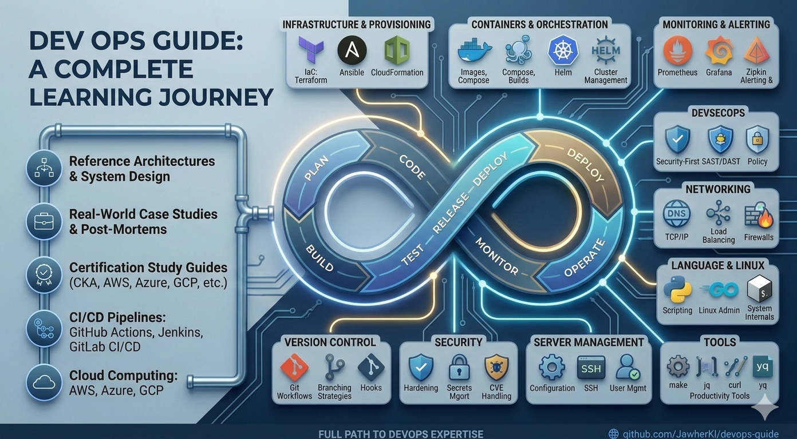

# 🚀 DevOps Guide

<p align="center">
  
  
  
  
  
  
  
</p>

<p align="center">
  
</p>

<p align="center">
  A hands-on, practitioner-focused guide to the <strong>full DevOps lifecycle</strong> — from Linux foundations and networking, to containers, CI/CD, cloud infrastructure, observability, and security.<br/><br/>
  📖 <a href="https://medium.com/@jawherkl/the-ultimate-devops-guide-from-zero-to-ci-cd-mastery-8ec4ee72fb65">Read the companion article on Medium</a>
</p>

---

## 📋 Table of Contents

- [About](#-about)
- [Repository Structure](#-repository-structure)
- [Topics Covered](#-topics-covered)
- [Getting Started](#-getting-started)
- [Tools & Technologies](#️-tools--technologies)
- [Roadmap](#-roadmap)
- [Contributing](#-contributing)
- [License](#-license)

---

## 🧭 About

**DevOps Guide** is a practical, community-driven repository that maps the full DevOps engineering path. Content is organized into focused topic folders — each with real configurations, working Dockerfiles, architecture diagrams, and annotated examples you can actually run.

The scope goes beyond the usual CI/CD-and-Docker tutorials: it covers Linux, networking, server management, programming languages used in DevOps, cloud providers, certification prep, and real-world case studies.

> ⚠️ **Work in progress** — the repository is actively evolving. Some topics have more depth than others. Stars, issues, and pull requests are all welcome.

---

## 📁 Repository Structure

```
devops-guide/
├── architecture/           # System design diagrams and reference architectures
├── images/                 # Assets used across documentation
├── topics/                 # Core content — one folder per DevOps domain
│   ├── case-studies/       # Real-world scenarios and post-mortems
│   ├── certification/      # Study guides for DevOps certifications (CKA, AWS, etc.)
│   ├── ci-cd/              # Pipelines: GitHub Actions, Jenkins, GitLab CI/CD
│   ├── cloud/              # AWS, Azure, GCP — provisioning, IAM, networking
│   ├── containers/         # Docker — images, Compose, multi-stage builds
│   ├── devsecops/          # Security-first DevOps: scanning, policies, SAST/DAST
│   ├── infrastructure/     # IaC: Terraform, Ansible, CloudFormation
│   ├── language/           # DevOps scripting: Python, Go, Bash
│   ├── linux/              # Linux administration, shell, system internals
│   ├── monitoring/         # Prometheus, Grafana, Zipkin, alerting, tracing
│   ├── networking/         # DNS, TCP/IP, load balancing, proxies, firewalls
│   ├── orchestration/      # Kubernetes, Helm, cluster management
│   ├── security/           # Hardening, secrets management, CVE handling
│   ├── server-management/  # Configuration, services, SSH, user management
│   ├── tools/              # Productivity tools: make, jq, curl, yq, etc.
│   └── version-control/    # Git workflows, branching strategies, hooks
├── .gitignore
├── LICENSE
└── README.md
```

---

## 📚 Topics Covered

### 🐧 Linux
The foundation of every DevOps environment. Covers the filesystem hierarchy, process management, shell scripting, permissions, cron jobs, and system internals that every engineer should know.

### 🌐 Networking
Essential networking concepts for infrastructure work — TCP/IP, DNS resolution, HTTP/HTTPS, load balancing, reverse proxies (Nginx, HAProxy), firewalls, and VPNs.

### 🖥️ Server Management
Day-to-day server operations: SSH hardening, user and permission management, service management with `systemd`, package management, and configuration best practices.

### 🔄 CI/CD
Continuous Integration and Deployment pipelines with GitHub Actions, Jenkins, and GitLab CI/CD. Includes real pipeline files targeting containerized applications, with stages for build, test, security scan, and deploy.

### 🐳 Containers
Docker from basics to advanced patterns — optimized image layering, multi-stage builds, Docker Compose for local dev and test environments, and image security best practices. The repository is 100% Dockerfile-based for fully runnable examples.

### ☸️ Orchestration
Kubernetes workloads and cluster management. Covers Deployments, Services, ConfigMaps, Secrets, resource limits, health probes, RBAC, and Helm chart authoring.

### 🏗️ Infrastructure (IaC)
Reproducible, version-controlled infrastructure using Terraform, Ansible, and AWS CloudFormation. Examples focus on idempotency, state management, and real cloud targets.

### ☁️ Cloud
Provider-specific guides for **AWS**, **Azure**, and **GCP** — IAM, VPC/networking, compute, storage, managed services, and cost awareness. Covers both CLI and IaC approaches side by side.

### 📊 Monitoring
Full observability stack: Prometheus metrics collection, Grafana dashboards, Zipkin distributed tracing, and alerting rules. Includes pre-built dashboard configs and trace analysis patterns for microservices.

### 🔐 DevSecOps
Security integrated at every pipeline stage — container image scanning with **Trivy**, dependency auditing with **Snyk**, DAST with **OWASP ZAP**, and policy-as-code patterns.

### 🔒 Security
Infrastructure and application hardening — secrets management, CVE triage workflows, TLS/PKI basics, and least-privilege access patterns.

### 🛠️ Tools
The everyday DevOps toolbox: `make`, `jq`, `yq`, `curl`, `direnv`, and other utilities that make workflows faster and more reproducible.

### 💻 Language
Scripting and automation in **Python**, **Go**, **Bash** and **JavaScript** — the three most common languages in DevOps tooling and automation workflows.

### 🌿 Version Control
Git workflows (GitFlow, trunk-based development), commit conventions, branching strategies, git hooks, and pull request best practices for both infrastructure and application teams.

### 🏆 Certification
Structured study material for popular DevOps certifications: CKA (Certified Kubernetes Administrator), AWS DevOps Professional, Terraform Associate, and more.

### 📂 Case Studies
Real-world scenarios, architecture breakdowns, and post-mortems that illustrate how the tools and practices in this guide come together in production systems.

---

## 🚀 Getting Started

### Prerequisites

- Git
- Docker & Docker Compose (for most hands-on examples)

### Clone the repository

```bash
git clone https://github.com/JawherKl/devops-guide.git
cd devops-guide
```

### Pick a topic and dive in

```bash
# Example: start with Linux foundations
cd topics/linux

# Example: run a container example
cd topics/containers

# Example: explore a CI/CD pipeline
cd topics/ci-cd
```

Each topic folder contains its own `README.md` with context, prerequisites, and step-by-step instructions.

---

## 🛠️ Tools & Technologies

| Category | Tools |
|---|---|
| **CI/CD** | GitHub Actions, Jenkins, GitLab CI/CD, CircleCI |
| **Containers** | Docker, Docker Compose |
| **Orchestration** | Kubernetes, Helm |
| **Infrastructure (IaC)** | Terraform, Ansible, AWS CloudFormation |
| **Cloud** | AWS, Azure, Google Cloud |
| **Monitoring & Tracing** | Prometheus, Grafana, Zipkin |
| **Logging** | ELK Stack (Elasticsearch, Logstash, Kibana), Graylog |
| **Security** | Trivy, Snyk, OWASP ZAP |
| **Messaging & Caching** | Kafka, Redis |
| **Deployment & Management** | ArgoCD, Portainer |
| **Languages** | Python, Go, Bash |
| **Version Control** | Git, GitHub |

---

## 🗺️ Roadmap

- [x] Repository structure and organization
- [x] Containers — Docker, Compose, multi-stage builds
- [x] CI/CD — GitHub Actions, Jenkins, GitLab
- [x] Orchestration — Kubernetes, Helm
- [x] Infrastructure as Code — Terraform, Ansible
- [x] Monitoring & Tracing — Prometheus, Grafana, Zipkin
- [x] DevSecOps — Trivy, Snyk, OWASP ZAP
- [x] Version Control — Git workflows and strategies
- [ ] Linux — complete coverage of administration and internals
- [ ] Networking — DNS, TCP/IP, proxies, firewalls
- [ ] Cloud — deep dives for AWS, Azure, GCP
- [ ] Language — Python, Go, Bash scripting guides
- [ ] Server Management — SSH, systemd, user management
- [ ] Tools — jq, make, yq, and daily-use utilities
- [ ] Security — hardening, secrets management, CVE workflows
- [ ] Certification study packs — CKA, AWS DevOps Pro, Terraform Associate
- [ ] Case studies — real-world architecture and post-mortems
- [ ] GitOps — ArgoCD / Flux
- [ ] Service mesh — Istio / Linkerd
- [ ] CONTRIBUTING.md and issue templates

---

## 🤝 Contributing

All contributions are welcome — new examples, fixes, additional topics, or improved explanations.

```bash
# 1. Fork the repository and clone locally
git clone https://github.com/JawherKl/devops-guide.git

# 2. Create a branch scoped to the topic you're working on
git checkout -b feat/linux-process-management

# 3. Add your content and commit with a descriptive message
git commit -m "feat(linux): add process management and signals guide"

# 4. Push and open a Pull Request
git push origin feat/linux-process-management
```

Please keep examples **runnable**, include a brief explanation of what each configuration does, and test locally before submitting.

---

## 📬 Feedback & Discussions

Found an issue? Have a topic request? Open an [issue](https://github.com/JawherKl/devops-guide/issues) or start a conversation in the [Discussions](https://github.com/JawherKl/devops-guide/discussions) tab.

---

## 📜 License

This repository is licensed under the [MIT License](LICENSE).

---

## 🌟 Star History

<a href="https://www.star-history.com/?repos=jawherkl%2Fdevops-guide&type=date&legend=top-left">
 <picture>
   <source media="(prefers-color-scheme: dark)" srcset="https://api.star-history.com/chart?repos=jawherkl/devops-guide&type=date&theme=dark&legend=top-left" />
   <source media="(prefers-color-scheme: light)" srcset="https://api.star-history.com/chart?repos=jawherkl/devops-guide&type=date&legend=top-left" />
   
 </picture>
</a>
